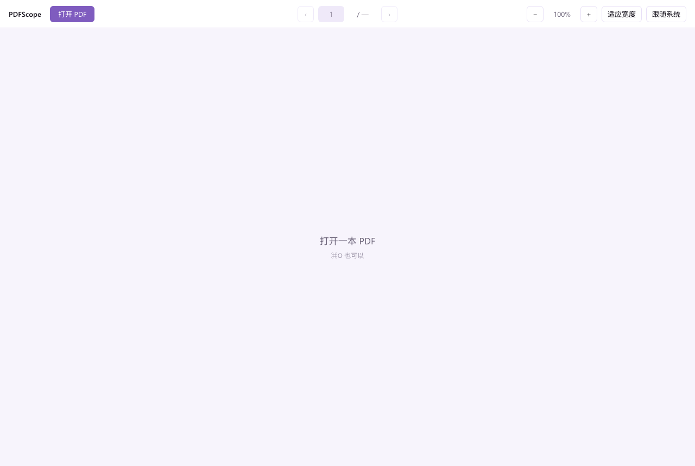

<div align="center">

# PDFScope

**Read PDFs with AI. Page by page, with citations that actually point to the page.**

[](https://github.com/polaritus9801/pdfscope/actions/workflows/ci.yml)
[](LICENSE)
[](rust-toolchain.toml)

</div>

---

PDFScope is a local-first PDF reader that puts an AI beside the page you are reading. Select text,
drag a box around a figure, or point it at a page range — the answer comes back with the page it
came from, so you can check it instead of trusting it.

It is not a notes app. Your notes stay in the tools you already use: copy a citation-ready block
into Obsidian, Typora, or anything that takes Markdown.

## Why

Feeding a whole PDF to a chat model loses the one thing that makes reading possible: **the page**.
Answers arrive without provenance, scans have no text layer at all, and a 400-page book becomes a
single undifferentiated blob.

PDFScope is built around the opposite assumption — the page is the unit of work.

- **Text, boxes, and ranges.** Ask about a selection, a dragged rectangle, one page, or a chapter.
- **Citations that resolve.** Every answer carries the page it drew from; click it and you are there.
- **Scans are first-class.** When a page has no text layer, it is rendered and read visually, not
  silently skipped.
- **Small and local.** Native binaries, keys in the OS keychain, no account, no upload of your library.

## Status

The MVP loop is implemented and unit-tested; it has not yet been walked in a desktop window.
What works, in code:

- a continuous reader: every page in one column, only visible pages rendered, pinch and wheel zoom
  anchored under the pointer, page field following the scroll, `⌘↑`/`⌘↓` to the ends;
- select text, capture a region, or type a page range;
- configure one provider (OpenAI-compatible or Anthropic), with the key in the OS keychain and a
  connection test before saving;
- ask, with the reference tray as the only context, and stream the answer with reasoning kept separate;
- click a citation to jump back to its page;
- stop an answer, retry a failed one, and redeem earlier references from history.

The walkthrough that turns "implemented" into "verified" is in [`docs/acceptance.md`](docs/acceptance.md).
The audit that produced the current findings is in [`docs/review.md`](docs/review.md).



## Stack

| Layer | Choice | Why |
|---|---|---|
| Shell | [Tauri 2](https://tauri.app) | Native binaries, system WebView, small download |
| UI | [Leptos](https://leptos.dev) + design tokens | Rust end to end; no framework churn |
| PDF | [PDF.js](https://mozilla.github.io/pdf.js/) | The only mature text layer with selection and layout |
| Core | Rust workspace | Boundaries that survive contributors |
| Storage | SQLite via `sqlx` | One file, no server, same on every OS |

The reasoning, including the options rejected, is in [`docs/ARCHITECTURE.md`](docs/ARCHITECTURE.md).

## Build

```sh
git clone https://github.com/polaritus9801/pdfscope.git
cd pdfscope
just setup   # installs git hooks, checks toolchain
just check   # fmt + clippy + tests
```

Requires Rust (see [`rust-toolchain.toml`](rust-toolchain.toml)). `just` is optional but assumed
throughout this repository.

## Contributing

Read [`AGENTS.md`](AGENTS.md) first — it is the protocol every change follows, human or AI. In
short: no product code without an approved spec, one vertical slice per commit, and a definition
of done that includes tests and documentation.

- [Architecture](docs/ARCHITECTURE.md)
- [Specifications](docs/specs/)
- [Decision records](docs/adr/)
- [Contributing](CONTRIBUTING.md)
- [Security policy](SECURITY.md)

## License

[MIT](LICENSE)
